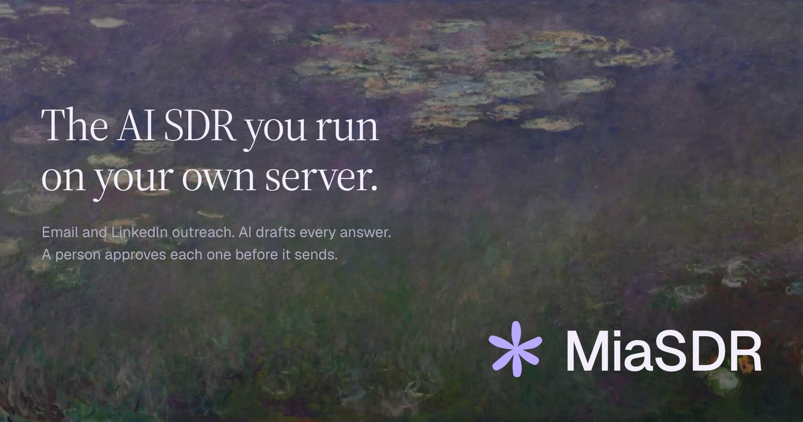
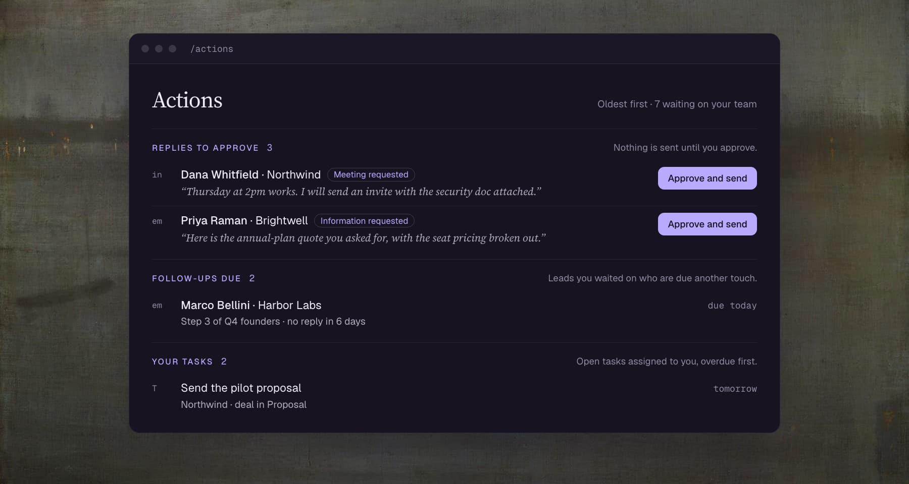
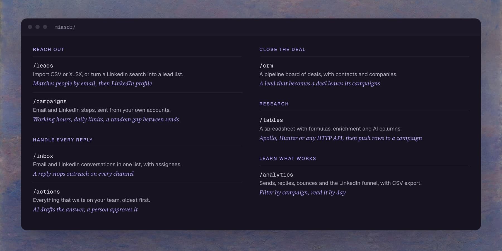
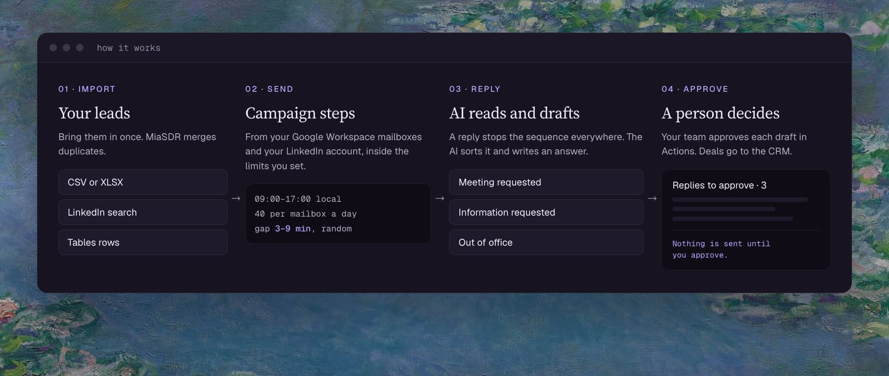

# MiaSDR

<p align="center"></p>

[](LICENSE)   

An outbound SDR for email and LinkedIn that runs on your server, sends from your accounts and keeps every lead in your database.

You import leads and run sequences from your own Google Workspace mailboxes and LinkedIn account. When someone replies, outreach to that person stops on every channel, the AI sorts the reply and drafts an answer, and a person on your team approves it before it sends.

## Quick start

**1. Start it.** You need Docker with Compose v2. The whole setup takes about ten minutes.

```bash
git clone https://github.com/Additor/MiaSDR.git && cd MiaSDR
cp .env.example .env
# replace each CHANGEME in .env with a value from: openssl rand -hex 32
docker compose up -d --build
```

**2. Create your organization.** Open `http://localhost:3000` and create the first account. The app runs its database migrations on boot.

**3. Look around, then connect.** Set `MAILBOX_PROVIDER=fake` in `.env` to try campaigns without Google: the fake provider keeps mail in memory and sends nothing. To send real email, follow [Gmail setup](docs/setup/gmail.md).

The [quick start guide](docs/guides/quick-start.md) walks from install to a first campaign.

<p align="center"></p>

## Why MiaSDR

| Problem | What MiaSDR does |
|---|---|
| Outbound tools keep your leads on their servers | Leads, conversations and deals live in your Postgres. Integration credentials are encrypted with a key only your server holds |
| AI SDRs send whatever the model writes | The AI drafts. Nothing it writes sends until a person on your team approves it |
| A lead replies on LinkedIn and still gets the next email | A reply on any channel stops that person's sequence in every campaign. A hard bounce or an unsubscribe blocks the address |
| Send rules hide behind a vendor's dashboard | You set working hours, daily limits per mailbox and a random gap between sends, and one variable pauses all outbound |
| Leads, inbox, CRM and research sit in four tools | One app and one database, from the first import to the closed deal |

## Features

<p align="center"></p>

**Reach out**

- **Leads**: import CSV or XLSX, or turn a LinkedIn search into a lead list. People match by email, then LinkedIn profile.
- **Campaigns**: email steps from your Google Workspace mailboxes and LinkedIn invitations and messages through [Unipile](docs/setup/linkedin-unipile.md). When a lead replies, hand the conversation to a person or let AI draft the follow-ups for approval.

**Handle every reply**

- **Inbox**: email and LinkedIn conversations in one list. Assign a conversation to a teammate.
- **Actions**: everything that waits on your team, oldest first: replies to approve, follow-ups due, tasks and problems.

**Close the deal**

- **CRM**: a pipeline board of deals, with contacts and companies. A lead that becomes a deal leaves its campaigns.

**Research**

- **Tables**: a spreadsheet with formulas, enrichment from Apollo, Hunter or any HTTP API, and AI columns. Push a table's rows to a campaign in one step.

**Learn what works**

- **Analytics**: sends, replies, bounces and the LinkedIn funnel, filtered by campaign, with CSV export.

## How it works

<p align="center"></p>

1. You import leads from a file, a LinkedIn search or a table.
2. Campaigns send from your mailboxes and your LinkedIn account, inside the working hours and limits you set.
3. A reply stops the sequence on every channel. The AI classifies it and drafts an answer with your organization's Anthropic key.
4. Your team approves each draft in Actions. A lead that turns into a deal moves to the CRM.

[How MiaSDR works](docs/guides/how-it-works.md) covers the jobs, the send engine and the inbox in more depth.

## Deploy

Docker Compose is the supported deployment: the app container and Postgres 17, with Caddy in front for HTTPS. [Self-hosting](docs/deploy/self-host.md) covers the server, backups and upgrades. Serverless hosts are untested.

| Item | Cost |
|---|---|
| MiaSDR, Docker, Postgres | Free, on a server you already have |
| Google Cloud project, Gmail API, service account | Free |
| Google Workspace mailboxes | You already pay for these if you send from a company domain |
| AI replies | Your Anthropic API usage, per organization key |
| Resend for auth emails | Optional, free tier |
| Caddy and Let's Encrypt for HTTPS | Free |
| LinkedIn through Unipile | Paid. Unipile has no free tier |

## Safety and privacy

- MiaSDR sends no AI-written message until a person approves it.
- Your data stays in your database. The app calls Google, Unipile, Anthropic and enrichment providers only with keys you give it.
- `PAUSE_OUTBOUND=true` stops every email and LinkedIn send on the server until you turn it off.
- Unsubscribes, hard bounces and do-not-contact flags block an address across every campaign.
- LinkedIn prohibits automation and can restrict accounts, and CAN-SPAM, GDPR and CASL set rules for who you may contact. Read [Responsible use](docs/responsible-use.md) before you send to real people.

## Docs

| Start here | Set up | Run it |
|---|---|---|
| [Quick start guide](docs/guides/quick-start.md) | [Gmail](docs/setup/gmail.md) | [Self-hosting](docs/deploy/self-host.md) |
| [How MiaSDR works](docs/guides/how-it-works.md) | [LinkedIn through Unipile](docs/setup/linkedin-unipile.md) | [Configuration](docs/configuration.md) |
| [Responsible use](docs/responsible-use.md) | [Apollo enrichment](docs/setup/apollo.md) | [Operations](docs/operations.md) |

## License

[AGPL-3.0-or-later](LICENSE).

- Run it for your own company freely.
- If you distribute a modified copy, or run one as a service for other people over a network, publish your modified source under the same license.
- Leads, conversations and reports you create with MiaSDR are your content.

The LICENSE file is the binding text.
