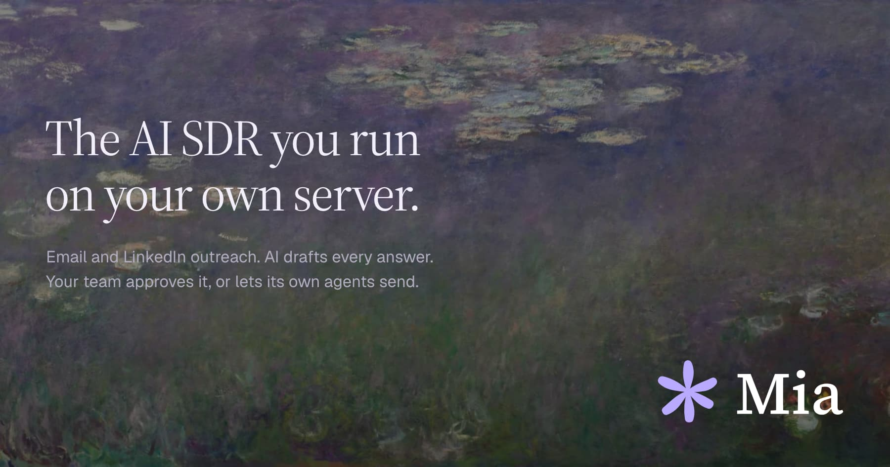
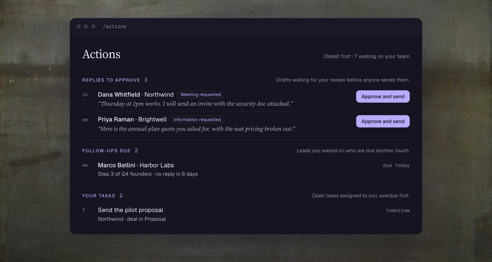
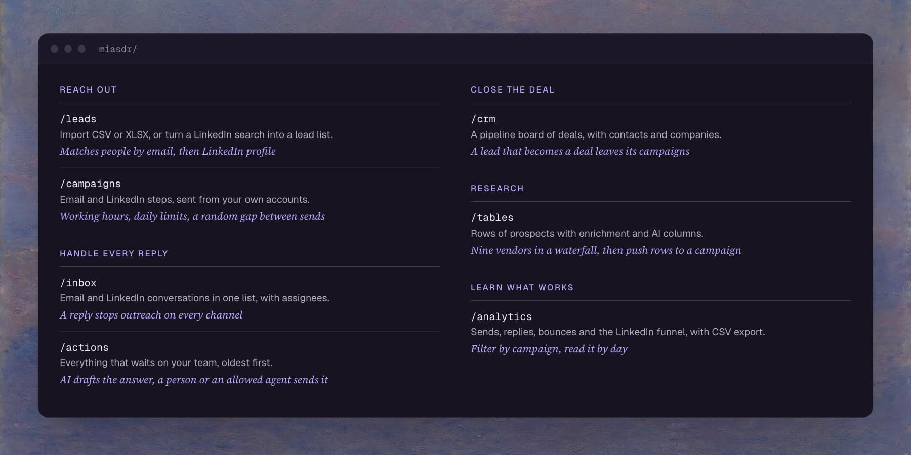
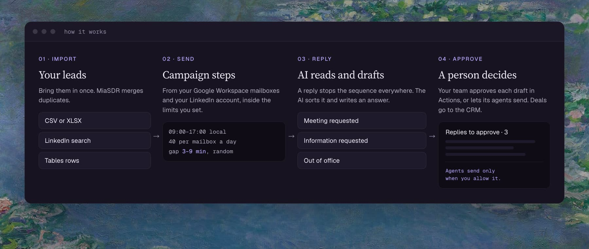

# MiaSDR

<p align="center"></p>

[](LICENSE)  

An AI SDR for email and LinkedIn that your agents can run. It lives on your server and sends from your own accounts.

- **Your agent works it from chat.** An MCP server ships inside the app, so Claude Code, Cursor or VS Code can clear the inbox, build campaigns and enrich leads.
- **The AI drafts, your team sends.** No AI-written message leaves until a person approves it, unless an admin lets your own MCP agents send within daily limits.
- **A reply anywhere stops everything.** Someone answers on LinkedIn and their email sequence stops too. If they ask you to stop, agents can't write to them and no campaign can add them until a person reviews it.
- **Your leads stay yours.** Leads, conversations and deals live in your Postgres, not a vendor's.

Free to run on your own server. You pay only for your AI provider's usage (Anthropic, Vercel AI Gateway or OpenRouter), plus Unipile if you use LinkedIn.

## Built for agents

Every install serves the [Model Context Protocol](https://modelcontextprotocol.io) at `/api/mcp`, with nothing extra to deploy. An owner or admin turns it on in Settings, each person creates a token, and the agent connects:

```bash
claude mcp add --transport http miasdr https://miasdr.example.com/api/mcp --header "Authorization: Bearer msdr_pat_..."
```

Then ask for the work in your own words:

- "What's waiting on me today? Draft answers to the replies so I can review them."
- "Run this LinkedIn search, then build a draft campaign for the people it finds."
- "Which campaign had the best reply rate last month? Pause the one with the most bounces."

Apps such as claude.ai and ChatGPT sign in with OAuth and skip the token.

You choose how far each agent goes:

| Access | What the agent can do |
|---|---|
| Read | Inbox, work queue, leads, campaigns, pipeline, analytics, tables |
| Make changes | Draft replies, sort conversations, manage tasks, prepare campaigns, move deals, import leads |
| Send | Send replies and start campaigns, within daily limits |
| Spend | Run paid enrichment and LinkedIn searches, within a daily limit in dollars and results |
| Complete and delete | Complete a campaign, or delete a lead, contact, deal or draft campaign, one previewed target at a time |

Sending, spending and deleting stay off until an owner or admin allows them. An agent acts as the person who made its token, and no tool changes the unsubscribe or suppression lists. The [MCP guide](docs/guides/mcp.md) lists each tool, limit and refusal.

## Quick start

**1. Start it.** You need Docker with Compose v2. The whole setup takes about ten minutes.

```bash
git clone https://github.com/Additor/MiaSDR.git && cd MiaSDR
cp .env.example .env
# replace each CHANGEME in .env with a value from: openssl rand -hex 32
docker compose up -d --build
```

**2. Create your organization.** Open `http://localhost:3000` and create the first account.

**3. Look around, then connect.** Set `MAILBOX_PROVIDER=fake` in `.env` to try campaigns without Google: the fake provider keeps mail in memory and sends nothing. To send real email, set `APP_URL` to this server's public address, because every email's unsubscribe link uses it, then follow [Gmail setup](docs/setup/gmail.md).

The [quick start guide](docs/guides/quick-start.md) walks from install to a first campaign.

<p align="center"></p>

## Features

<p align="center"></p>

- **Leads**: import CSV or XLSX, or turn a LinkedIn search into a lead list.
- **Campaigns**: email from your Google Workspace mailboxes, LinkedIn invitations and messages through [Unipile](docs/setup/linkedin-unipile.md), inside the working hours and daily limits you set. When a mailbox loses access, its leads wait and carry on from the same step once access returns.
- **Inbox and Actions**: every conversation in one list, and one queue for replies to approve, follow-ups due and tasks.
- **CRM**: a pipeline board of deals. A lead becomes a contact when you create a deal from it, and leaves its campaigns.
- **Tables**: AI columns that write a field for every row and a waterfall across nine enrichment vendors, one step from a campaign.
- **Analytics**: sends, replies, bounces and the LinkedIn funnel per campaign.

**In preview:** LinkedIn outreach and the enrichment vendors. Tests run them against local stand-ins and live key checks, but no full LinkedIn campaign has run on a real account and no vendor has run with a paid key. Start small and watch the results.

<p align="center"></p>

## Deploy and safety

Docker Compose runs the app and Postgres 17, with Caddy in front for HTTPS. [Self-hosting](docs/deploy/self-host.md) covers the server, backups and upgrades.

- `PAUSE_OUTBOUND=true` holds every campaign send, email and LinkedIn, and every agent reply, until you turn it off. Replies you approve still send.
- LinkedIn prohibits automation and can restrict accounts, and CAN-SPAM, GDPR and CASL limit who you may contact. Read [Responsible use](docs/responsible-use.md) before you send to real people.

## Docs

| Start here | Set up | Run it |
|---|---|---|
| [Quick start guide](docs/guides/quick-start.md) | [Gmail](docs/setup/gmail.md) | [Self-hosting](docs/deploy/self-host.md) |
| [AI agents (MCP)](docs/guides/mcp.md) | [LinkedIn through Unipile](docs/setup/linkedin-unipile.md) | [Configuration](docs/configuration.md) |
| [How MiaSDR works](docs/guides/how-it-works.md) | [Enrichment providers](docs/setup/enrichment.md) | [Operations](docs/operations.md) |
| [Responsible use](docs/responsible-use.md) | [Sender DNS: SPF, DKIM, DMARC](docs/guides/sender-dns.md) | |

## License

[AGPL-3.0-or-later](LICENSE).

- Run it for your own company freely.
- If you distribute a modified copy, or run one as a service for other people over a network, publish your modified source under the same license.
- Leads, conversations and reports you create with MiaSDR are your content.

The LICENSE file is the binding text.
